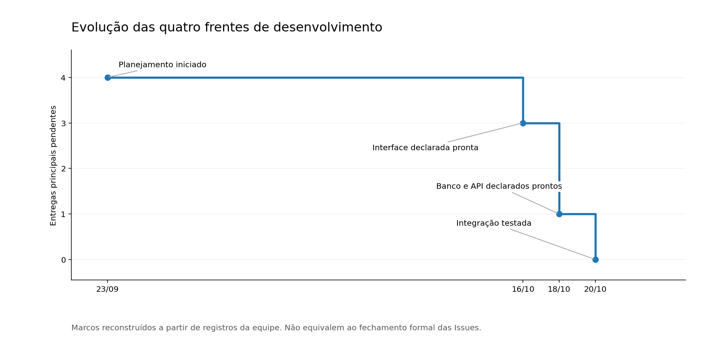

# Relatório técnico — Federal Servant Search

Sistemas para Internet II — Trabalho do 3º bimestre

Período de desenvolvimento: setembro e outubro de 2026

## 1. Objetivo

O Federal Servant Search reúne informações públicas sobre servidores ativos e aposentados do Poder Executivo Federal em uma interface web de consulta. O sistema permite filtrar por nome, cargo, órgão e UF, combinar critérios e navegar por resultados paginados. Também dispõe de pesquisa por similaridade e por padrões com `%`, além de um cliente desktop que utiliza a mesma API.

## 2. Equipe, metodologia e organização do desenvolvimento

O desenvolvimento foi inicialmente organizado com base em práticas do Scrum, utilizando o GitHub para gerenciar atividades, prazos, critérios de aceite e versionamento do código. Makgregor Alves Altê assumiu as funções de Scrum Master e líder técnico, com responsabilidade pelo planejamento, distribuição de tarefas, Docker, integração, testes e acompanhamento do projeto.

As quatro frentes foram definidas em Issues reais do repositório:

| Frente | Integrante | Participação no desenvolvimento |
|---|---|---|
| Banco de dados (DB-01) | Gerson Oliveira | Análise inicial das fontes oficiais, incluindo a identificação da ausência de UF nos dados de Aposentados. |
| Backend/API Flask (BE-01) | Lucas Preigschadt | Responsabilidade atribuída no planejamento inicial. Não houve implementação dessa frente disponível para integração. |
| Frontend React (FE-01) | Yuri Silveira | Estrutura inicial React/Vite, telas e atualizações da interface publicadas na branch de frontend. |
| Docker e integração (INT-01) | Makgregor Alves Altê | Coordenação técnica, Docker, integração e testes; assumiu também a implementação do banco e da API e contribuiu na interface de pesquisa. |

O planejamento previa desenvolvimento paralelo, entregas intermediárias e branches por frente. O acompanhamento ocorreu predominantemente por mensagens assíncronas; não foram realizadas reuniões diárias formais.

### 2.1. Desenvolvimento e redistribuição das atividades

Durante a execução, chuvas intensas e instabilidade no fornecimento de energia dificultaram a comunicação e a disponibilidade de integrantes. O calendário de provas, os compromissos profissionais e circunstâncias pessoais também afetaram o cronograma. Diante desses impedimentos, os prazos intermediários foram reajustados.

Gerson Oliveira analisou as bases de Aposentados e Carreiras/Cargos e identificou diferenças nos campos disponíveis. Essa frente, porém, não resultou em uma implementação de banco entregue à integração. Yuri Silveira deu continuidade ao frontend, apesar dos períodos de menor disponibilidade, e publicou seus avanços no GitHub.

O backend havia sido atribuído a Lucas Preigschadt. Sem uma implementação disponível para integrar, a liderança técnica assumiu a API. Lucas saiu do grupo de comunicação em 13/10. Posteriormente, Makgregor também assumiu o banco de dados, seguindo a política de redistribuição estabelecida no início: tarefas críticas sem avanço ou comunicação poderiam ser assumidas ou redistribuídas para evitar o bloqueio do projeto.

Com a disponibilização das telas desenvolvidas por Yuri, as frentes foram consolidadas no ambiente de integração, seguidas pela preparação dos dados oficiais, correções e testes. A distribuição das tarefas precisou ser adaptada ao longo do desenvolvimento; o acompanhamento planejado não ocorreu integralmente.

### 2.2. Cronologia

| Data | Atividade registrada |
|---|---|
| 21/09 | Criação da estrutura inicial no repositório. |
| 22–23/09 | Planejamento no GitHub e atribuição das frentes de trabalho. |
| 25/09 | Acompanhamento das primeiras tarefas e reajuste dos prazos intermediários. |
| 29/09 | Comunicação sobre instabilidade elétrica e informação da prorrogação do prazo para 20/10. |
| 03/10 | Identificação da ausência do campo UF na fonte de Aposentados. |
| 08–19/10 | Evolução e publicação da interface React, conforme histórico de commits. |
| 13/10 | Saída de Lucas do grupo de comunicação. |
| 18–20/10 | Consolidação de banco, API e frontend; importação de dados, integração e testes. |

### 2.3. Histórico de commits

O repositório utilizado é [federal-servant-search](https://github.com/Makgregor-Alte/federal-servant-search). A tabela apresenta os oito commits encontrados no histórico das branches existentes, por data, autor registrado e identificador. A descrição sintetiza o assunto de cada commit.

| Data | Autor registrado | Commit | Atividade |
|---|---|---|---|
| 21/09/2026 | Mak-PC-Mãe (Makgregor) | `dd33fd1` | Estrutura inicial do projeto. |
| 08/10/2026 | yurij-s (Yuri) | `12f9c04` | Base React/Vite e páginas de login e cadastro. |
| 13/10/2026 | Mak-PC-Mãe (Makgregor) | `7c2c768` | Integração de PostgreSQL, Flask e Docker. |
| 13/10/2026 | Mak-PC-Mãe (Makgregor) | `421dec5` | Interface de pesquisa de servidores. |
| 14/10/2026 | yurij-s (Yuri) | `88d3a60` | Melhorias nas telas e início da tela principal. |
| 16/10/2026 | yurij-s (Yuri) | `67983dd` | Continuação da tela principal. |
| 16/10/2026 | yurij-s (Yuri) | `5ecdbdc` | Conclusão das telas principais, ainda sem integração ao backend. |
| 19/10/2026 | yurij-s (Yuri) | `d8c18be` | Ajustes dos arquivos de frontend para Docker e retirada de código de teste das páginas. |

O fluxo de commits não ocorreu com a regularidade inicialmente planejada. Parte das atividades de implementação, importação de dados e validação foi consolidada localmente antes da preparação para publicação; por isso, os commits acima registram marcos publicados, não cada alteração individual. As branches do repositório preservam o histórico dos integrantes que realizaram publicações.

### 2.4. Acompanhamento das entregas



O gráfico apresenta a evolução das quatro frentes principais, com marcos de conclusão da interface em 16/10, banco e API em 18/10 e integração em 20/10. Foi elaborado a partir dos marcos de desenvolvimento registrados pela equipe, e não das datas de encerramento das Issues no GitHub.

## 3. Arquitetura

A aplicação utiliza três serviços Docker Compose:

1. PostgreSQL 17 (`db`), responsável pelo armazenamento, índices e registro dos lotes de importação.
2. Flask/Gunicorn (`backend`), responsável pelos filtros, consultas SQL, paginação e respostas JSON.
3. Nginx e React/TypeScript (`frontend`), responsáveis pela interface e pelo encaminhamento das rotas `/api/`.

```text
Navegador / Desktop → Nginx → Flask/Gunicorn → PostgreSQL
```

No acesso web, o navegador consulta a API por HTTP no próprio domínio. O cliente Tkinter envia as mesmas requisições. A aplicação não exige autenticação para pesquisas públicas.

## 4. Preparação do banco de dados

Foram utilizadas duas fontes de dados abertos do Poder Executivo Federal, ambas da competência maio/2026: Aposentados e Carreiras/Cargos. Os arquivos foram tratados em Python para identificar colunas, normalizar campos de pesquisa e importar os registros em lotes. A origem e a competência são registradas em `lotes_importacao`; a chave `(fonte, id_origem)` evita inserir novamente a mesma linha da fonte.

| Fonte | Registros importados | Registros rejeitados |
|---|---:|---:|
| Carreiras/Cargos | 1.085.301 | 2 |
| Aposentados | 412.147 | 130 |
| Total | 1.497.448 | 132 |

Durante a leitura de Aposentados, foram descartadas 207 linhas físicas na recuperação de registros CSV malformados; essa contagem é distinta dos 130 registros rejeitados. O campo UF está ausente no conjunto de Aposentados e, por isso, permanece sem preenchimento quando não existe na fonte.

O PostgreSQL utiliza índices B-tree e índices GIN com a extensão `pg_trgm` para consultas textuais e por similaridade. Os scripts de criação do esquema e dos índices ficam em `db/`; os arquivos oficiais não integram o pacote. O procedimento de importação consta em [Banco de dados](../DATABASE.md).

## 5. API e tratamento de erros

O endpoint principal é `GET /api/servidores` (também disponível como `/api/servants`). Aceita os parâmetros `name`/`nome`, `name_mode`, `similar`, `position`/`cargo`, `agency`/`orgao`, `uf`, `page`/`pagina` e `page_size`/`limit` (máximo 100).

Exemplo:

```http
GET /api/servidores?nome=Maria&uf=RS&pagina=1&limit=20
```

A resposta utiliza JSON com os arrays `items` e o objeto `pagination`. Os filtros são validados antes do SQL, que utiliza parâmetros vinculados para impedir injeção por concatenação de entradas. A API diferencia parâmetros inválidos (400), páginas inexistentes (404), método não permitido (405), requisições grandes rejeitadas (413, conforme o limite aplicável), indisponibilidade do banco (503) e consultas ou bloqueios que excederam o tempo permitido (504). O Nginx responde 429 quando o limite de requisições é ultrapassado.

O contrato completo está em [Contrato HTTP](../API_CONTRACT.md).

## 6. Interfaces web e desktop

O frontend utiliza React, TypeScript e Vite; o Nginx publica os arquivos compilados e encaminha `/api/` ao backend. O formulário disponibiliza busca exata, similaridade, padrões com `%`, cargo, órgão, UF e combinação de filtros. Os resultados podem ser paginados e examinados individualmente.

O aplicativo desktop utiliza Python/Tkinter e consome a API por HTTP, sem acessar diretamente o PostgreSQL. O código está em `desktop/`, e o executável compilado para Windows integra a distribuição em `desktop/release/FederalServantSearch.exe`.

## 7. Execução e testes

Na raiz da pasta `projeto/`, o sistema inicia com:

```bash
docker compose up --build
```

A interface fica disponível em `http://localhost:8080/sistema`, e o endpoint de saúde em `/api/health`. Um banco novo começa sem registros e precisa receber os arquivos oficiais por importação, descrita em [Banco de dados](../DATABASE.md).

Foram verificados o contrato HTTP, cenários de busca e entradas inválidas, testes unitários e de integração e testes de carga. Na bateria funcional completa, com 1.497.448 registros, todas as 92 verificações passaram (59 HTTP 200, 30 HTTP 400 esperados, 2 HTTP 404 e 1 HTTP 405). O p95 dessa bateria foi 991,93 ms.

| Teste de carga | Resultado |
|---|---|
| Carga moderada, 40 requisições, 2 trabalhadores | 40 HTTP 200; p95 de 40,72 ms |
| Rajada, 80 requisições, 8 trabalhadores | 11 HTTP 200 e 69 HTTP 429; p95 agregado de 73,21 ms |
| Busca fuzzy concorrente, 4 requisições | 4 HTTP 504; aproximadamente 6,0–6,1 s |

O endpoint de saúde respondeu HTTP 200 após os ensaios. Os JSON originais de cada execução estão em `anexos_http/`: `auditoria_funcional_92.json`, `carga_moderada_40.json`, `rajada_80.json`, `falha_fuzzy_concorrente.json` e `falha_inicial_sem_filtros.json`. Os dois últimos documentam erros reais observados, e não falhas de geração de arquivos.

Além da bateria HTTP, foram registrados 453 testes de backend aprovados, quatro ignorados, seis testes de limites HTTP aprovados e 25 testes do frontend aprovados nas execuções realizadas ao longo do desenvolvimento. Esses resultados correspondem a execuções distintas da bateria HTTP de 92 casos.

## 8. Limitações e mecanismos de proteção

O Nginx aplica limitação de 5 requisições por segundo por IP, com rajada de 10. Isso evita o encaminhamento irrestrito de solicitações rápidas ao backend e foi observado no ensaio com respostas 429. A porta direta do backend, entretanto, não passa pelo limitador Nginx.

O Gunicorn está configurado com 2 workers e 2 threads por worker. Os limites de execução SQL são de 3 s para pesquisas comuns e 6 s para busca semelhante. A contagem exata de resultados e a paginação profunda podem tornar consultas amplas mais lentas. A consulta sem filtros apresentou HTTP 504 em um ensaio inicial, mas respondeu normalmente na bateria posterior; quatro buscas fuzzy concorrentes retornaram HTTP 504. O comportamento sob carga de similaridade continua sendo uma limitação do sistema.

O p95 da rajada inclui respostas 429 rejeitadas rapidamente e não representa a latência apenas das consultas atendidas. Resultados de carga moderada e de rajada não caracterizam o desempenho de consultas fuzzy concorrentes.

## 9. Avaliação da metodologia e dificuldades da equipe

A divisão inicial em frentes tornou claras as responsabilidades e permitiu que o frontend evoluísse paralelamente à estrutura de integração. O uso de Issues e branches ajudou a organizar o planejamento e registrar parte das contribuições.

A principal dificuldade organizacional foi manter a continuidade das atividades em meio à instabilidade de energia, aos períodos de provas e aos compromissos profissionais. A comunicação assíncrona nem sempre ocorreu na frequência necessária, e a saída de um integrante exigiu redistribuição das tarefas. A política de assumir atividades críticas permitiu dar continuidade à implementação, mas concentrou banco, API e integração na liderança técnica.

Como melhorias para projetos futuros, destacam-se o acompanhamento mais frequente das Issues, o registro contínuo das alterações no Git e a revisão antecipada dos prazos intermediários. O planejamento baseado em Scrum foi útil para definir prioridades, embora a execução tenha exigido adaptações.

## 10. Conclusão

O sistema foi integrado e executado com os dois conjuntos oficiais, com interfaces web e desktop, filtros combinados e busca textual indexada. A bateria funcional e os testes de proteção por limite de requisições foram aprovados nos cenários descritos. Permanecem limitações de desempenho em pesquisas semelhantes simultâneas. O histórico real de commits e os ajustes de organização da equipe estão documentados neste relatório.
